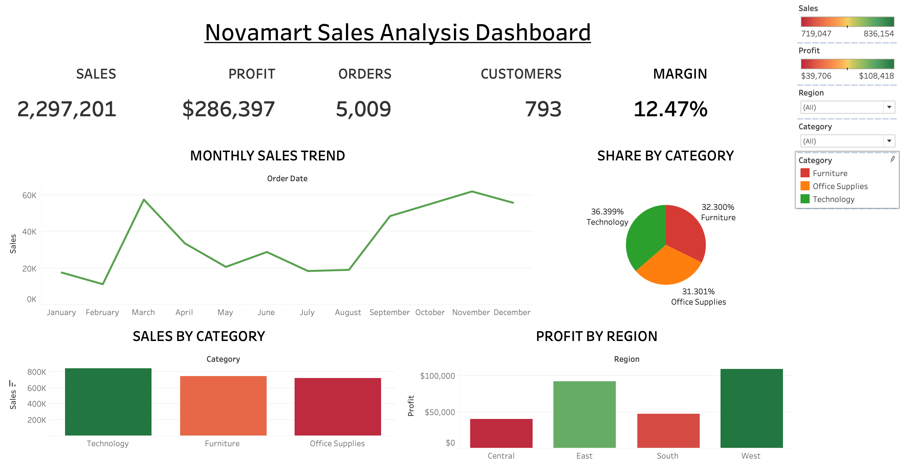
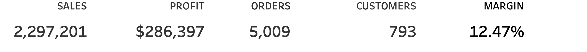
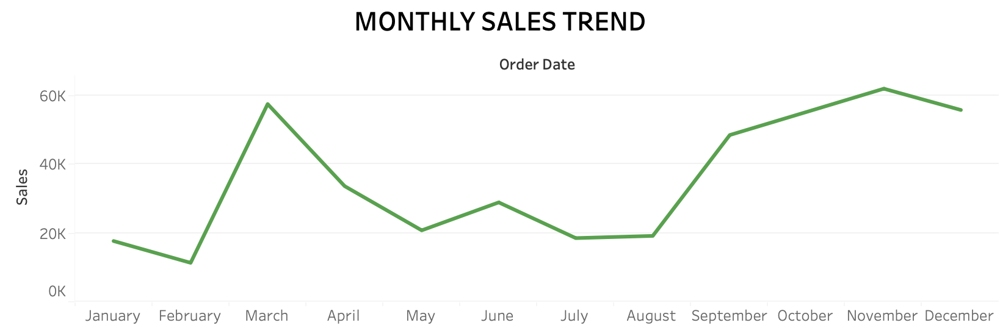
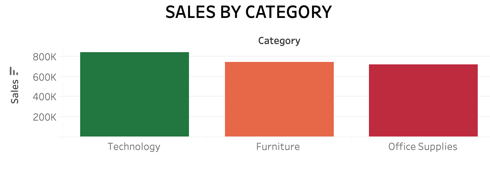
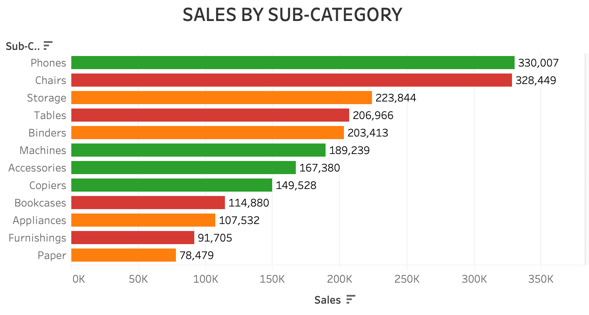
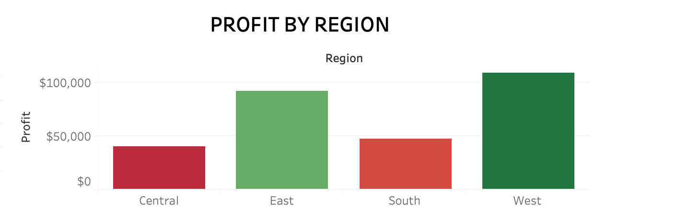
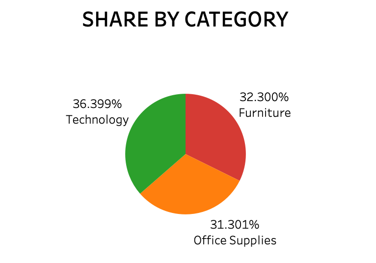
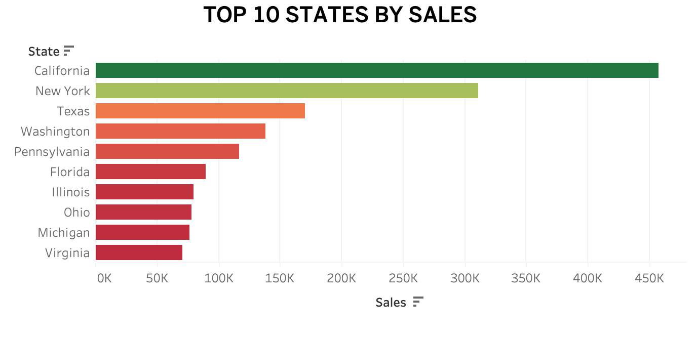

# NovaMart Retail Sales Analytics

An end-to-end retail sales analytics project using the **Sample Superstore** dataset. It combines Python-based data cleaning and exploratory analysis, SQL business queries, and an interactive Tableau Public executive dashboard to explore sales, profitability, customer performance, discounts, shipping, and regional trends.

## Dashboard Preview



The Tableau dashboard includes KPI cards, monthly sales trend, category contribution, sales by sub-category, profit by region, and the top 10 states by sales. Region and category filters support interactive exploration.

### Dashboard Components

| View | Preview |
|---|---|
| Executive KPIs — Sales, Profit, Orders, Customers, Profit Margin |  |
| Monthly Sales Trend |  |
| Sales by Category |  |
| Sales by Sub-Category |  |
| Profit by Region |  |
| Sales Share by Category |  |
| Top 10 States by Sales |  |

## Project Highlights

- **Data cleaning and feature engineering:** inspect missing values and duplicates, remove duplicate records, parse order and ship dates, and create `Shipping Days`, `Month`, `Year`, `Quarter`, and `Profit Margin` features.
- **Exploratory data analysis (EDA):** investigate monthly, quarterly, and yearly sales; category and segment performance; customer and state performance; product losses; shipping modes; and discount/profit patterns.
- **Statistical analysis:** use a correlation heatmap to examine linear relationships among Sales, Profit, Discount, Quantity, and Shipping Days.
- **SQL analysis:** a query file contains examples for customer profitability, loss-making products, state profitability, average shipping time, and row-count checks. Load the cleaned data into a SQLite table named `sales` before running these queries.
- **Interactive Tableau dashboard:** combine headline KPIs with trend and breakdown charts to support business review.

## Key Dashboard KPIs

Values shown for the full Sample Superstore dataset before filtering:

| KPI | Value |
|---|---:|
| Total Sales | $2,297,201 |
| Total Profit | $286,397 |
| Total Orders | 5,009 |
| Total Customers | 793 |
| Profit Margin | 12.47% |

These values can change when dashboard filters are applied. The orders KPI should count **distinct Order IDs**, not individual line items.

## Python Analysis Visuals

The notebook saves visualizations in `novamart-retail-sales-analytics/Graphs/`.

### Sales Trends

| Monthly Sales | Quarterly Sales | Yearly Sales Trend |
|---|---|---|
|  |  |  |

### Category, Segment, and Profitability Analysis

| Sales by Category | Sales by Segment | Discount vs Profit |
|---|---|---|
|  |  |  |

### Correlation Heatmap


**Interpretation note:** correlation describes association, not causation. Discount/profit patterns should be investigated alongside product, category, and order context before making pricing decisions.

## Tools and Technologies

- **Python:** Pandas, NumPy, Matplotlib, Seaborn
- **Notebook:** Jupyter Notebook
- **SQL:** SQLite-compatible business queries
- **Visualization:** Tableau Public
- **Data:** Sample Superstore CSV

## Repository Structure

```text
.
├── README.md
├── requirements.txt
└── novamart-retail-sales-analytics/
    ├── dashboard/
    │   └── E-commerce sales analysis dashboard.twbx
    ├── data/
    │   ├── Sample - Superstore.csv
    │   └── cleaned_superstore.csv
    ├── Graphs/
    │   ├── Category_preview.png
    │   ├── Discount_profit_preview.png
    │   ├── Heatmap_preview.png
    │   ├── Monthly_Sales_preview.png
    │   ├── Quaterly_Sales_preview.png
    │   ├── Segment_preview.png
    │   └── Yearly_Sales_Trend_preview.png
    ├── images/
    │   ├── executive-dashboard.png
    │   ├── executive-kpis.png
    │   ├── monthly-sales-trend.png
    │   ├── sales-by-category.png
    │   ├── sales-by-subcategory.png
    │   ├── profit-by-region.png
    │   ├── category-share.png
    │   └── top-10-states-by-sales.png
    ├── notebooks/
    │   └── analysis.ipynb
    └── sql/
        └── bussiness_queries.sql
```

## Run the Python Analysis

1. Clone or download the repository.
2. From the repository root, create and activate a virtual environment if desired.
3. Install the dependencies:

   ```bash
   pip install -r requirements.txt
   ```

4. Open `novamart-retail-sales-analytics/notebooks/analysis.ipynb` in VS Code or Jupyter.
5. Run the notebook cells in order. The notebook reads `data/Sample - Superstore.csv`, performs cleaning and analysis, and exports `data/cleaned_superstore.csv`.

The notebook's relative paths assume it is run from its included `notebooks` directory in a Jupyter environment.

## Run the SQL Queries

The query file is `novamart-retail-sales-analytics/sql/bussiness_queries.sql`. First load `cleaned_superstore.csv` into a SQLite database as a table named `sales`, then connect to that database using SQLTools or another SQLite client. Run one query at a time. Confirm the actual column names in the table before executing queries, because CSV column names may retain spaces and capitalization.

## Tableau Dashboard

Open `novamart-retail-sales-analytics/dashboard/E-commerce sales analysis dashboard.twbx` in Tableau Public/Desktop. The packaged workbook contains the dashboard and its embedded data source. Use the dashboard filters to compare regions and categories; clear filters to return to the overall KPI values.

## Potential Next Steps

- Customer segmentation using RFM analysis
- Sales forecasting
- Discount and margin optimization by sub-category
- Customer lifetime value analysis
- Inventory performance analysis
- Repeatable ETL workflow for cleaning, loading, and refreshing the SQLite dataset

## Repository

[GitHub repository](https://github.com/Kush1520/novamart-retail-sales-analytics) · [GitHub profile](https://github.com/Kush1520)
